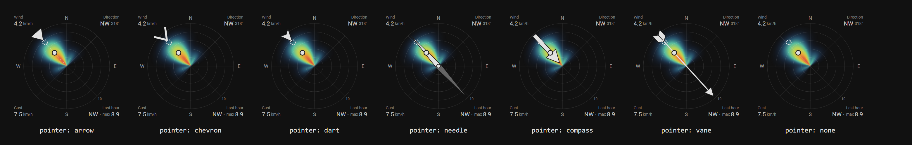
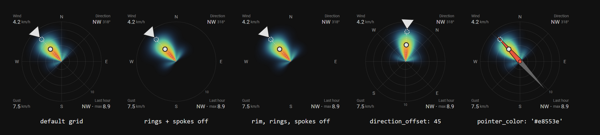
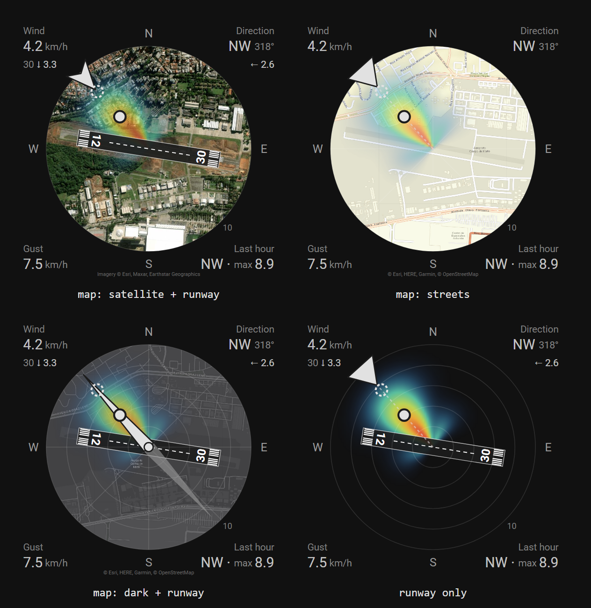
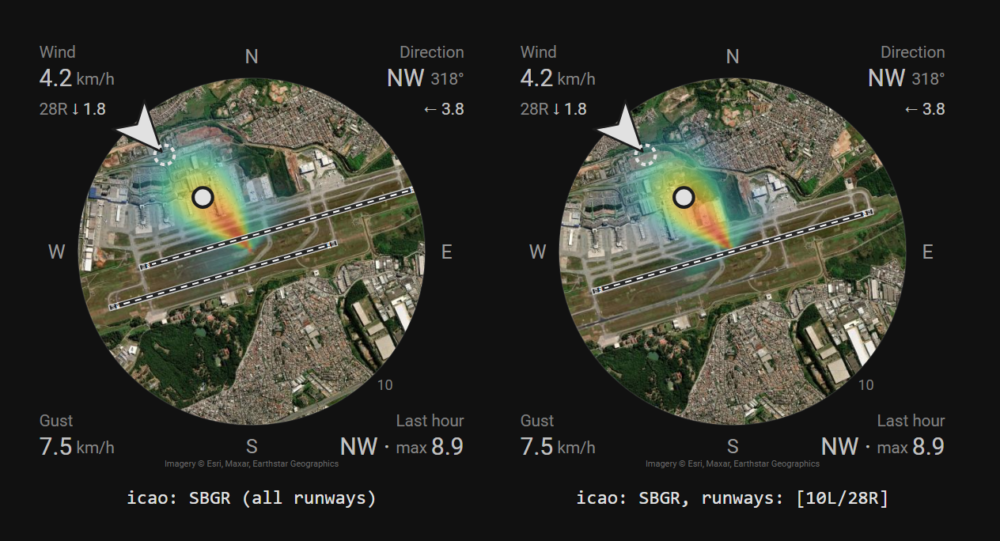
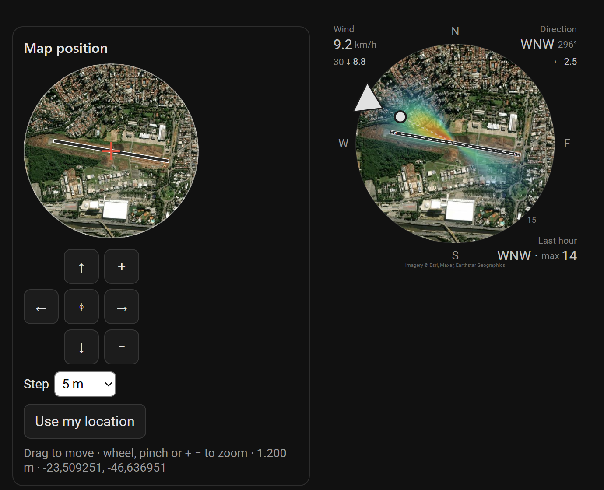
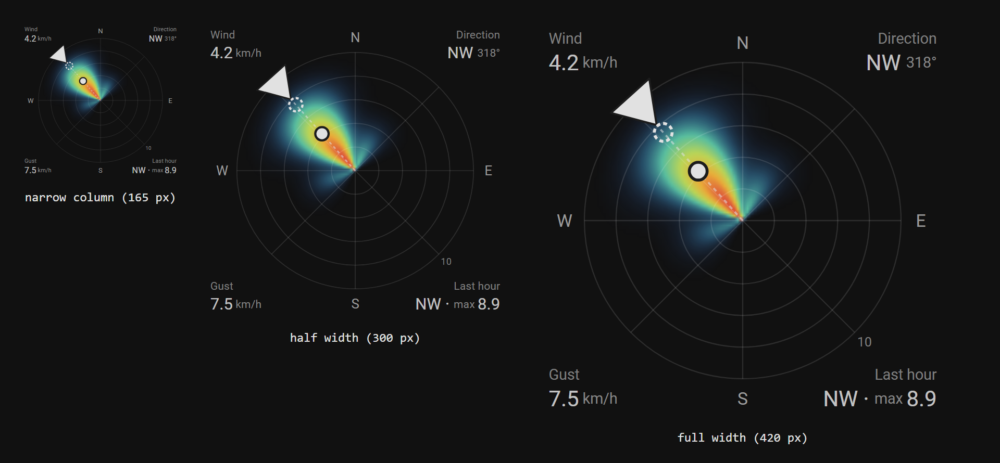

# PT2VHF Wind Rose

A compact Home Assistant Lovelace card that shows **where the wind is coming from, how strong it is, and what it did over the last hour** — in one glance.


The rose is a polar heat map that grows **from the centre outward** (`heat_mode: plume`, default):

- **angle** = direction the wind comes *from* (meteorological convention)
- **distance from the centre** = speed: every sample paints its direction from the centre out to the speed it reached, so each plume shows where the wind came from and how strong it got
- **colour** = share of time the wind came from that direction and reached at least that speed (blue = rare → red = most of the time)

`heat_mode: spots` draws the older look instead: a soft spot at each sample's direction and speed.

On top of it, a large arrow on the rim points in from the current direction, a solid dot marks the current wind and a dashed ring the current gust. The rose fills the card; the numbers sit quietly in the corners: current speed (and a rain note), direction, gust, and the window's prevailing direction and max.

Works in light and dark themes, in English and Portuguese (card and visual editor follow the HA language), in masonry and Sections dashboards. Everything scales with the card width.

## Gallery

**Pointer styles** — `pointer:` all mark the side the wind comes from.



**Heat map** — plumes grow from the centre out to the speed reached; `plume_width` and `plume_fade` shape them, `spots` is the alternative look and `heat_direction: to` draws them downwind, as if blown by the wind.


**Grid, rotation and colour** — hide any part of the grid, rotate the whole rose to match how you face the dashboard, colour the pointer.



**Background map and runway** — put your home (or airfield) under the rose: satellite, street, topographic, light or dark map, centred on the Home Assistant home location. Add a runway to see the wind against it, with the headwind (↓) and crosswind (← →) for the runway end in use.



**Aerodrome by ICAO code** — `icao: SBGR` finds the runways (OurAirports data); pick the ones you want with `runways`. Over a map they are drawn at their real place and size.



**Map position in the visual editor** — see the map, drag it, zoom it (wheel, pinch, + −), nudge it by metres or use your device's location. Everything is saved in the card.



**Any width** — everything scales with the card, from a narrow column to full width.



## Install

### Home Assistant Marketplace (2026.11+)

1. **Settings → Marketplace → Add from link**, enter `alexpmr/pt2vhf-wind-rose` (type **Dashboard** if asked). A GitHub connection is required.
2. Install **PT2VHF Wind Rose** and reload the browser. The Marketplace adds the dashboard resource for you (unless your resources are managed in YAML).

Older Home Assistant with HACS: add the same URL as a custom repository, type **Dashboard**.

### Manual

Copy `pt2vhf-wind-rose-card.js` to `config/www/`, then add a dashboard resource `/local/pt2vhf-wind-rose-card.js` (type *JavaScript module*).

## Configuration

```yaml
type: custom:pt2vhf-wind-rose-card
# Sensors
entity: sensor.wind_speed             # required – wind speed
direction_entity: sensor.wind_bearing # required – direction in degrees (0 = N)
gust_entity: sensor.wind_gust         # optional
rain_entity: binary_sensor.raining    # optional
name: Wind
# Heat map
window: 1h                # 15m, 30m, 1h, 2h, 3h, 6h, 12h, 24h
heat_mode: plume          # plume | spots
heat_direction: from      # from = toward where the wind came from | to = blown downwind
plume_width: 15           # plume thickness (degrees)
plume_fade: 40            # how gradually each plume tip fades (% of radius)
smooth: 8                 # spot softness (heat_mode: spots)
heat_motion: false        # true = heat map sways with the speed and flickers with the gusts
calm: 0.5                 # speeds below this are left out
max_speed: 0              # 0 = auto scale
# Orientation
direction_offset: 0       # rotate the whole rose clockwise (display only)
# Pointer
pointer: arrow            # arrow | chevron | dart | needle | compass | vane | none
pointer_color: ''         # empty = text colour
show_guide: true
show_speed: true
show_gust: true
# Grid
show_rim: true
show_rings: true
show_spokes: true
show_scale: true
rings: 5
sectors: 16
# Background map
map: none                 # none | satellite | streets | topo | light | dark | custom
map_radius: 150           # metres from the centre to the rim
map_opacity: 100
heat_opacity: 100         # lower it (e.g. 70) to see the map through the heat
map_center: home          # home | device | an entity with coordinates, e.g. person.me
map_shift_north: 0        # fine adjustment in metres (negative = south)
map_shift_east: 0         # (negative = west)
map_latitude: ''          # fixed centre; empty = use map_center
map_longitude: ''
map_url: ''               # map: custom, e.g. https://…/{z}/{x}/{y}.png
# Runway
icao: ''                  # aerodrome code, e.g. SBMT
runways: []               # e.g. [12/30]; empty = all open runways
runway_heading: ''        # true heading of one end, e.g. 99; empty = no runway
runway_name: ''           # painted numbers, e.g. 12/30; empty = from the heading
runway_length: 70         # % of the rose diameter
runway_width: 8
runway_wind: true         # headwind / crosswind for the runway end in use
# Size and refresh
max_width: 380
refresh: 60
tap_action:
  action: more-info
```

A new card added from the card picker starts with this full list (the same options as the visual editor), so every setting is there to change later.

| Option | Default | Description |
| --- | --- | --- |
| `entity` | — | Wind speed sensor. Its unit is shown as is. |
| `direction_entity` | — | Wind direction sensor, numeric degrees. |
| `gust_entity` | — | Gust sensor (optional). |
| `rain_entity` | — | Rain sensor (optional): a `binary_sensor` (`on`) or a numeric rate/amount (> 0). Shows a "rain" note only while it rains. |
| `tap_action` | `more-info` | Standard Home Assistant action on tap (`more-info` of the speed sensor by default, `navigate`, `none`, …). |
| `name` | Wind | Label of the speed corner. |
| `window` | `1h` | History window of the heat map: minutes or hours, e.g. `15m`, `30m`, `1h`, `1.5h`, `24h` (a plain number = minutes). |
| `hours` | `1` | Older way to set the window in whole hours; ignored when `window` is set. |
| `direction_offset` | `0` | Rotates the whole rose clockwise by this many degrees (N/E/S/W labels, grid, heat map and pointer) so it matches how the viewer faces the dashboard. Display only: measured values and the direction text stay true. |
| `max_speed` | auto | Speed at the rim. Auto picks a round value above the window's peak. |
| `sectors` | `16` | Direction bins used for the prevailing direction (4–64). |
| `rings` | `5` | Number of speed circles drawn on the grid (never changes the heat map). |
| `show_guide` | `true` | Dashed line from the arrow to the centre (`arrow` pointer only). |
| `show_speed` | `true` | Solid dot at the current speed, in the current direction (distance from the centre = speed). |
| `show_gust` | `true` | Dashed ring at the current gust, same direction and scale (needs `gust_entity`). |
| `show_rim` | `true` | Show the outer circle (the rose outline). |
| `show_rings` | `true` | Show the inner speed circles. |
| `show_spokes` | `true` | Show the 8 radial lines. |
| `show_scale` | `true` | Show the rim speed label. |
| `pointer` | `arrow` | Current-direction pointer. All mark the side the wind comes from: `arrow` (triangle on the rim + guide line), `chevron` (open V on the rim), `dart` (slim notched arrowhead on the rim), `needle` (compass needle through the centre), `compass` (wide arrow from the rim to the centre), `vane` (weather vane across the rose: feathers on the "from" side, head where the wind blows to) or `none`. |
| `pointer_color` | text colour | Any CSS colour for the pointer, e.g. `#e8553e` or `var(--accent-color)`. |
| `calm` | `0.5` | Speeds below this count as calm and are left out of the heat map. |
| `max_width` | `380` | Maximum size of the rose in px on wide cards. |
| `heat_mode` | `plume` | `plume`: heat grows from the centre out to the speed reached in each direction. `spots`: a soft spot at each sample. |
| `heat_direction` | `from` | `from`: the heat points to where the wind came from (meteorological wind rose). `to`: the heat is drawn downwind, as if blown by the wind; the speed dot and gust ring follow it, the pointer stays on the "from" side. |
| `plume_width` | `15` | Plume thickness in degrees: higher merges nearby directions and hides thin streaks. |
| `plume_fade` | `40` | How gradually each plume tip fades, in % of the radius: higher removes hard arcs (useful with sensors that report speed in steps); 0 = sharp tip. |
| `smooth` | `8` | Spot size for `heat_mode: spots` (% of the radius). |
| `heat_motion` | `false` | Animates the heat map: it sways like a windsock (more and faster with stronger wind) and flickers like a flame (more and faster when gusts exceed the speed). Turned off when the device asks for reduced motion. |
| `refresh` | `60` | Seconds between history reloads. |
| `map` | `none` | Background map under the heat map: `satellite` (Esri World Imagery), `streets` (Esri), `topo` (OpenTopoMap), `light` / `dark` (Esri Canvas), or `custom` with `map_url`. It rotates with `direction_offset`. |
| `map_radius` | `150` | Metres from the centre to the rim. The zoom is picked from it. |
| `map_opacity` | `100` | Map opacity, %. |
| `heat_opacity` | `100` | Heat-map opacity, %; around 60–75 lets the map show through. |
| `map_center` | `home` | `home` (with `icao` set: the aerodrome), `device` (location of the device showing the card; asks permission once, needs HTTPS) or an entity with coordinates (`person.me`, `zone.home`…). |
| `map_shift_north`, `map_shift_east` | `0` | Moves the centre by metres; negative = south / west. The editor's map preview sets them by dragging. |
| `map_latitude`, `map_longitude` | — | Fixed map centre; wins over `map_center` and `icao`. |
| `map_url` | — | Tile template for `map: custom` (`{z}`, `{x}`, `{y}`; http/https only). `map_attribution` sets its credit line. |
| `icao` | — | Aerodrome code. Runways come from OurAirports (about 4 MB, downloaded once and then cached for 30 days). With a map, runways whose coordinates are known are drawn at their real place and size; otherwise through the centre. |
| `runways` | all open | Runways to draw, by name, e.g. `[10L/28R]`. |
| `runway_heading` | — | Draws a runway through the centre along this **true** heading of one end (as seen on the map). Empty = no runway. |
| `runway_name` | from heading | Painted numbers, e.g. `12/30` or `11L/29R` (they are magnetic, so they can differ from the true heading). The first number is the end at `runway_heading`. |
| `runway_length`, `runway_width` | `70`, `8` | Runway size in % of the rose diameter. |
| `runway_wind` | `true` | Shows, under the top corners, the runway end with most headwind (among all drawn) with its headwind (↓, ↑ = tailwind) and crosswind (← wind from the right, → from the left). |

With a map, the browser downloads the map images from the provider for the map centre (your home location by default), so that provider sees the location. `icao` downloads the runway list from OurAirports (GitHub Pages). With `map: none` (default) and no `icao`, the card makes no outside requests and never asks for your location. The map services belong to third parties: check their terms for your use, or use your own with `map: custom`. Wind components are informational, not for flight operations.

The card reads history through the recorder (`history/history_during_period`), so both sensors must be recorded. Direction sensors that report text (e.g. `NW`) are not supported — use a numeric degree sensor.

## Troubleshooting

**An option does nothing, or the card behaves like an older version.** Usually an older copy of the card is still loaded: only the first copy that loads is used. Open the browser console (F12) and look for `PT2VHF-WIND-ROSE <version>`; from 0.9.0 the card also prints a warning when another version is already loaded. Fix: keep a single `pt2vhf-wind-rose-card.js` entry in **Settings → Dashboards → ⋮ → Resources**, then clear the cache (Ctrl+F5, or *Reset frontend cache* in the companion app). The visual editor shows the running version under the wind speed field.

## Development

```sh
node --test test/*.test.mjs   # unit tests for the rose and density math
```

`demo/index.html` renders the card with a simulated `hass` object; serve the folder with any static server and open it. `demo/editor.html` shows the map-position editor and `demo/gallery.html?set=pointers|heat|grid|map|icao|sizes` renders the README images.

## License

MIT
