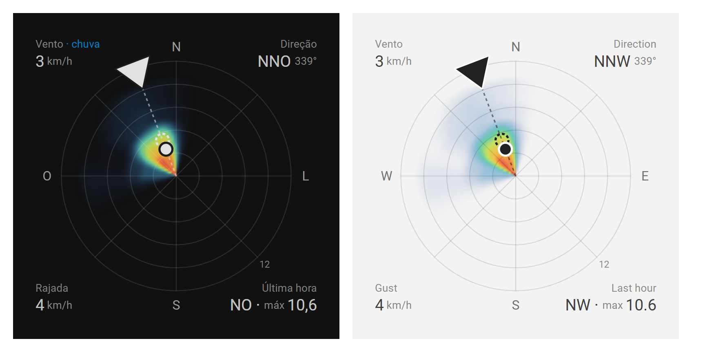
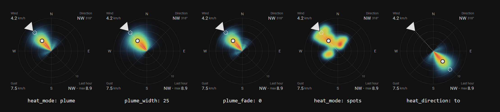

# PT2VHF Wind Rose

A compact Home Assistant Lovelace card that shows **where the wind is coming from, how strong it is, and what it did over the last hour** — in one glance.



The rose is a polar heat map that grows **from the centre outward** (`heat_mode: plume`, default):

- **angle** = direction the wind comes *from* (meteorological convention)
- **distance from the centre** = speed: every sample paints its direction from the centre out to the speed it reached, so each plume shows where the wind came from and how strong it got
- **colour** = share of time the wind came from that direction and reached at least that speed (blue = rare → red = most of the time)

`heat_mode: spots` draws the older look instead: a soft spot at each sample's direction and speed.

On top of it, a large arrow on the rim points in from the current direction, a solid dot marks the current wind and a dashed ring the current gust. The rose fills the card; the numbers sit quietly in the corners: current speed (and a rain note), direction, gust, and the window's prevailing direction and max.

Works in light and dark themes, in English and Portuguese (follows the HA language), in masonry and Sections dashboards. Everything scales with the card width.

## Gallery

**Pointer styles** — `pointer:` all mark the side the wind comes from.


**Heat map** — plumes grow from the centre out to the speed reached; `plume_width` and `plume_fade` shape them, `spots` is the alternative look and `heat_direction: to` draws them downwind, as if blown by the wind.



**Grid, rotation and colour** — hide any part of the grid, rotate the whole rose to match how you face the dashboard, colour the pointer.


**Any width** — everything scales with the card, from a narrow column to full width.


## Install

### Home Assistant Marketplace (2026.11+)

1. **Settings → Marketplace → Add from link**, enter `alexpmr/pt2vhf-wind-rose` (type **Dashboard** if asked). A GitHub connection is required.
2. Install **PT2VHF Wind Rose** and reload the browser. The Marketplace adds the dashboard resource for you (unless your resources are managed in YAML).

Older Home Assistant with HACS: add the same URL as a custom repository, type **Dashboard**.

### Manual

Copy `pt2vhf-wind-rose-card.js` to `config/www/`, then add a dashboard resource `/local/pt2vhf-wind-rose-card.js` (type *JavaScript module*).

## Configuration

```yaml
type: custom:pt2vhf-wind-rose-card
# Sensors
entity: sensor.wind_speed             # required – wind speed
direction_entity: sensor.wind_bearing # required – direction in degrees (0 = N)
gust_entity: sensor.wind_gust         # optional
rain_entity: binary_sensor.raining    # optional
name: Wind
# Heat map
window: 1h                # 15m, 30m, 1h, 2h, 3h, 6h, 12h, 24h
heat_mode: plume          # plume | spots
heat_direction: from      # from = toward where the wind came from | to = blown downwind
plume_width: 15           # plume thickness (degrees)
plume_fade: 40            # how gradually each plume tip fades (% of radius)
smooth: 8                 # spot softness (heat_mode: spots)
calm: 0.5                 # speeds below this are left out
max_speed: 0              # 0 = auto scale
# Orientation
direction_offset: 0       # rotate the whole rose clockwise (display only)
# Pointer
pointer: arrow            # arrow | chevron | dart | needle | compass | vane | none
pointer_color: ''         # empty = text colour
show_guide: true
show_speed: true
show_gust: true
# Grid
show_rim: true
show_rings: true
show_spokes: true
show_scale: true
rings: 5
sectors: 16
# Size and refresh
max_width: 380
refresh: 60
tap_action:
  action: more-info
```

A new card added from the card picker starts with this full list (the same options as the visual editor), so every setting is there to change later.

| Option | Default | Description |
| --- | --- | --- |
| `entity` | — | Wind speed sensor. Its unit is shown as is. |
| `direction_entity` | — | Wind direction sensor, numeric degrees. |
| `gust_entity` | — | Gust sensor (optional). |
| `rain_entity` | — | Rain sensor (optional): a `binary_sensor` (`on`) or a numeric rate/amount (> 0). Shows a "rain" note only while it rains. |
| `tap_action` | `more-info` | Standard Home Assistant action on tap (`more-info` of the speed sensor by default, `navigate`, `none`, …). |
| `name` | Wind | Label of the speed corner. |
| `window` | `1h` | History window of the heat map: minutes or hours, e.g. `15m`, `30m`, `1h`, `1.5h`, `24h` (a plain number = minutes). |
| `hours` | `1` | Older way to set the window in whole hours; ignored when `window` is set. |
| `direction_offset` | `0` | Rotates the whole rose clockwise by this many degrees (N/E/S/W labels, grid, heat map and pointer) so it matches how the viewer faces the dashboard. Display only: measured values and the direction text stay true. |
| `max_speed` | auto | Speed at the rim. Auto picks a round value above the window's peak. |
| `sectors` | `16` | Direction bins used for the prevailing direction (4–64). |
| `rings` | `5` | Number of speed circles drawn on the grid (never changes the heat map). |
| `show_guide` | `true` | Dashed line from the arrow to the centre (`arrow` pointer only). |
| `show_speed` | `true` | Solid dot at the current speed, in the current direction (distance from the centre = speed). |
| `show_gust` | `true` | Dashed ring at the current gust, same direction and scale (needs `gust_entity`). |
| `show_rim` | `true` | Show the outer circle (the rose outline). |
| `show_rings` | `true` | Show the inner speed circles. |
| `show_spokes` | `true` | Show the 8 radial lines. |
| `show_scale` | `true` | Show the rim speed label. |
| `pointer` | `arrow` | Current-direction pointer. All mark the side the wind comes from: `arrow` (triangle on the rim + guide line), `chevron` (open V on the rim), `dart` (slim notched arrowhead on the rim), `needle` (compass needle through the centre), `compass` (wide arrow from the rim to the centre), `vane` (weather vane across the rose: feathers on the "from" side, head where the wind blows to) or `none`. |
| `pointer_color` | text colour | Any CSS colour for the pointer, e.g. `#e8553e` or `var(--accent-color)`. |
| `calm` | `0.5` | Speeds below this count as calm and are left out of the heat map. |
| `max_width` | `380` | Maximum size of the rose in px on wide cards. |
| `heat_mode` | `plume` | `plume`: heat grows from the centre out to the speed reached in each direction. `spots`: a soft spot at each sample. |
| `heat_direction` | `from` | `from`: the heat points to where the wind came from (meteorological wind rose). `to`: the heat is drawn downwind, as if blown by the wind; the speed dot and gust ring follow it, the pointer stays on the "from" side. |
| `plume_width` | `15` | Plume thickness in degrees: higher merges nearby directions and hides thin streaks. |
| `plume_fade` | `40` | How gradually each plume tip fades, in % of the radius: higher removes hard arcs (useful with sensors that report speed in steps); 0 = sharp tip. |
| `smooth` | `8` | Spot size for `heat_mode: spots` (% of the radius). |
| `refresh` | `60` | Seconds between history reloads. |

The card reads history through the recorder (`history/history_during_period`), so both sensors must be recorded. Direction sensors that report text (e.g. `NW`) are not supported — use a numeric degree sensor.

## Development

```sh
node --test test/*.test.mjs   # unit tests for the rose and density math
```

`demo/index.html` renders the card with a simulated `hass` object; serve the folder with any static server and open it. `demo/gallery.html?set=pointers|heat|grid|sizes` renders the README images.

## License

MIT
